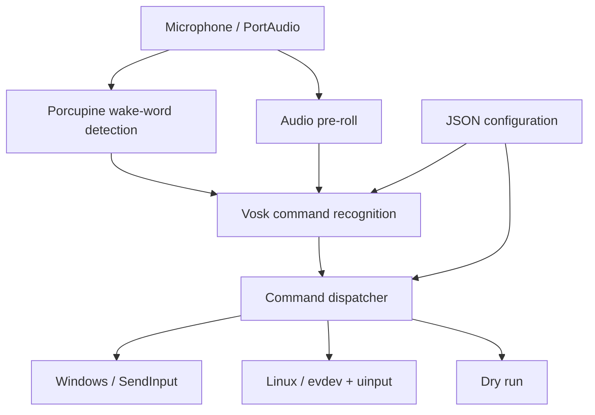

# dillaWOWVoiceForever

**Hands-free voice commands for World of Warcraft Forever.**

Say **“Jarvis, open map”** — no button, no artificial pause, no cloud speech service.

A lightweight Python application that combines local wake-word detection with configurable speech commands and native keyboard input. Designed for playing with a controller, but equally useful with a conventional keyboard.


## Contents

- [Features](#features)
- [Quick start — Windows](#quick-start--windows)
- [Voice commands](#voice-commands)
- [Configuration](#configuration)
- [Command-line reference](#command-line-reference)
- [Latency tuning](#latency-tuning)
- [Linux and Steam Deck](#linux-and-steam-deck)
- [Troubleshooting](#troubleshooting)
- [Architecture and development](#architecture-and-development)

## Features

- **Always-on wake word:** Jarvis, using Porcupine 1.9.5 without an AccessKey.
- **Offline speech recognition:** Vosk with a vocabulary derived from your command configuration.
- **Continuous phrases:** audio pre-roll allows commands such as “Jarvis open map” without waiting for a confirmation tone.
- **Three recognition modes:** normal, low latency and fast.
- **Custom keybindings:** individual keys, modifier combinations, aliases, hold times and generic timed sequences.
- **Native input backends:** Windows SendInput and experimental Linux evdev/uinput.
- **Dry run by default:** experiment with recognition before sending any input.
- **Local audio processing:** no audio recordings saved by the application; internet access is needed for dependency installation and the initial model download.

> **Game use:** Prefer one deliberately spoken command mapped to one in-game keybind. Use WoW's own supported macro system where appropriate. External timed multi-action sequences can violate game automation rules. This project does not imply Blizzard approval.

## Quick start — Windows

Requirements: Windows x64, 64-bit Python, Git and a working microphone. Python 3.11 is a reasonable starting point; the current Windows setup has also been exercised with Python 3.13.

Open PowerShell:

```powershell
git clone https://github.com/DoofDilla/dillaWOWVoiceForever.git
cd dillaWOWVoiceForever
python -m pip install -r requirements.txt
python main.py --mode fast
```

The first start downloads the English Vosk model (approximately 40 MB) into `models/vosk-model-small-en-us-0.15/`. Subsequent launches reuse it.

Say **“Jarvis open map”** in one natural phrase. A successful recognition prints a match and, unless disabled, plays a short success tone. No keys are sent in this initial test.

Example console output (illustrative):

```text
Mode: fast | Timeout: 3s | Output: DRY RUN
Waiting for jarvis... Press Ctrl+C to stop.
JARVIS detected! (#1) | pre-roll: 256 ms
Partial: open map
MATCH: 'open map' | confidence: n/a | wake-to-result: 0.95s | source: stable partial
DRY RUN: open map: [('key', ['m'], 50)]
Waiting for jarvis...
```

### Enable keyboard output

1. Edit `config.json` to match your actual WoW keybindings.
2. Start the application with output enabled:
   
   ```powershell
   python main.py --mode fast --enable-output
   ```
3. Bring WoW to the foreground and speak a command.

The application can remain in the background. Windows output is restricted by the configured foreground window title (case-insensitive substring match). It does not send keys specifically to a background WoW window.

To stop, return to the terminal and press **Ctrl+C**.

### Update an existing installation

```powershell
git pull
python -m pip install -r requirements.txt
```

Keep a separate copy of your personal config (see below) to avoid conflicts with future changes to the repository's example configuration.

## Voice commands

The default config includes these **example** bindings. They are not automatically read from WoW and must be adjusted to your own setup.

| Say after Jarvis | Example key |
| --- | --- |
| Open map | M |
| Close map | M |
| Inventory / Open bags | B |
| Mount | Shift+F5 |
| Pet attack | Ctrl+1 |
| Pet follow | Ctrl+2 |
| Pet stay | Ctrl+3 |
| Feign death | Shift+F6 |
| Target nearest | Tab |
| Auto run | Num Lock |

Open map and close map use the same toggle key in the supplied example; the application does not inspect game state.

## Configuration

All settings and spoken commands are defined in `config.json`. Changes are loaded at startup; restart the application after editing.

For a personal profile, copy the supplied file:

```powershell
Copy-Item config.json my-config.json
python main.py --config my-config.json --mode fast
```

On Linux, use `cp config.json my-config.json`. The alternative file is a complete configuration, not an overlay.

### Example configuration

This is a complete, minimal example with optional settings included:

```json
{
  "wake_word": "jarvis",
  "sensitivity": 0.6,
  "device": null,
  "beep": true,
  "wake_beep": false,
  "recognition": {
    "mode": "fast",
    "timeout": 3.0,
    "silence_ms": 300,
    "stable_ms": 200,
    "pre_roll_ms": 256
  },
  "output": {
    "foreground_title": "World of Warcraft",
    "default_hold_ms": 50
  },
  "commands": {
    "open map": {
      "key": "m"
    },
    "inventory": {
      "key": "b",
      "aliases": ["open bags", "show inventory"]
    },
    "mount": {
      "key": "shift+f5",
      "hold": 80
    }
  }
}
```

### General settings

| Setting | Supplied / effective default | Description |
| --- | --- | --- |
| `wake_word` | `"jarvis"` | A built-in keyword supported by Porcupine 1.9.5; not arbitrary text. |
| `sensitivity` | `0.6` | Wake-word sensitivity, from 0 to 1. Higher values may increase false activations. |
| `device` | `null` | Default microphone, or an integer device ID from `--list-devices`. |
| `beep` | `true` | Master switch for audio feedback. |
| `wake_beep` | `false` | Optional activation tone. Keep disabled for seamless speech. |

### Recognition settings

All fields below belong inside `recognition`.

| Setting | Supplied / effective default | Description |
| --- | --- | --- |
| `mode` | `"normal"` | Recognition strategy: normal, lowlatency or fast. The example above selects fast. |
| `timeout` | `3` | Maximum command window after wake detection, in seconds. |
| `silence_ms` | `300` | Requested trailing silence for the Vosk endpointer in optimized modes, where supported. |
| `stable_ms` | `200` | How long a matching partial result must remain unchanged in fast mode. |
| `pre_roll_ms` | `256` | Audio retained before and including the detection frame; 0–1000 ms, rounded up to whole frames. Zero restores the old handoff. |

### Output settings

| Setting | Default | Description |
| --- | --- | --- |
| `foreground_title` | `"World of Warcraft"` | Windows window-title filter. A JSON `null` disables it. Linux output requires `null`, because a foreground filter is not implemented there. |
| `default_hold_ms` | `50` | Default key/chord hold duration in milliseconds. |

Output is enabled only by the command-line flag `--enable-output`. A recognition match or success tone does not guarantee that the foreground guard allowed input or that a game accepted it.

### Define a single key

Add this entry inside the `commands` object:

```json
"open map": {
  "key": "m"
}
```

### Define a chord and hold duration

```json
"mount": {
  "key": "ctrl+shift+f5",
  "hold": 80
}
```

Use `+` for simultaneously held keys, with modifiers first and no spaces.

### Define aliases

```json
"inventory": {
  "key": "b",
  "aliases": ["open bags", "show inventory"]
}
```

Each alias maps to the same action. All names and aliases are normalized to lowercase and included in the Vosk grammar. Avoid duplicate phrases and words not supported by your speech model.

### Define a generic sequence

For ordinary desktop applications and testing, a binding can execute multiple steps:

```json
"desktop example": {
  "sequence": [
    {"key": "a", "hold": 50},
    {"wait": 250},
    {"key": "b"},
    {"wait": 100},
    {"key": "enter"}
  ]
}
```

| Property | Meaning |
| --- | --- |
| `key` | One key or a chord |
| `hold` | Optional hold time in milliseconds |
| `wait` | Pause in milliseconds |
| `sequence` | Ordered list of steps |

Sequences are limited to 32 steps and 10 seconds of configured hold/wait time. Durations must be integers from 0 to 10000. Use either a single-key binding or a sequence. For WoW, stick to single keybindings rather than external multi-action automation.

### Supported keys

| Category | Names |
| --- | --- |
| Letters | `a`–`z` |
| Digits | `0`–`9` |
| Function keys | `f1`–`f12` |
| Modifiers | `ctrl`, `shift`, `alt` |
| Common keys | `enter`, `tab`, `esc`, `space`, `backspace`, `numlock` |
| Navigation | `up`, `down`, `left`, `right`, `home`, `end`, `insert`, `delete`, `pageup`, `pagedown` |

Windows uses virtual-key codes; Linux uses physical key codes. Keyboard layouts may affect the result. Mouse buttons and controller buttons are not currently implemented.

## Command-line reference

Run `python main.py --help` for the argument parser's help.

CLI values override their corresponding config values for the current run only.

| Option | Description |
| --- | --- |
| `--help`, `-h` | Show available arguments. |
| `--config PATH` | Load a different complete JSON configuration. |
| `--list-devices` | List audio devices and exit. |
| `--device ID` | Select a microphone by numeric ID. |
| `--sensitivity FLOAT` | Override wake-word sensitivity (0–1). |
| `--timeout SECONDS` | Override command recognition timeout. |
| `--mode normal` | Standard final-result recognition. |
| `--mode lowlatency` | Request shorter endpoint delays and low audio-stream latency. |
| `--mode fast` | Additionally accept stable, unambiguous partial matches. |
| `--silence-ms MS` | Request trailing silence duration in optimized modes. |
| `--stable-ms MS` | Set partial stability duration in fast mode. |
| `--pre-roll-ms MS` | Set wake-word audio pre-roll (0–1000 ms). |
| `--wake-beep` | Enable activation feedback, unless all beeps are disabled. |
| `--no-beep` | Disable all feedback sounds. |
| `--free` | Use unrestricted Vosk transcription; only exact configured matches dispatch. |
| `--enable-output` | Enable native keyboard output; omitted means dry run. |
| `--model PATH` | Use a local Vosk model directory. If the path does not exist, the default English model is downloaded there. |

### Useful command lines

```shell
# List microphones
python main.py --list-devices

# Test a specific microphone
python main.py --device 3 --mode fast

# Compare unrestricted speech recognition
python main.py --free

# Fast recognition without feedback sounds
python main.py --mode fast --no-beep

# Run with your own profile and enable output
python main.py --config my-config.json --mode fast --enable-output
```

## Latency tuning

| Mode | Behavior | Trade-off |
| --- | --- | --- |
| Normal | Waits for a finalized Vosk result. | Baseline; generally slower. |
| Low latency | Requests shorter endpoint delays and a low-latency audio stream. | Endpoint API availability depends on installed Vosk version. |
| Fast | Also accepts a complete partial match stable for the configured duration, unless it is a prefix of a longer command. | Faster response, but partial hypotheses can be wrong. |

Start with:

```shell
python main.py --mode fast --stable-ms 200 --pre-roll-ms 256
```

Experiment with a shorter stability threshold:

```shell
python main.py --mode fast --stable-ms 100
```

If the beginning of a command is clipped when speaking continuously, try:

```shell
python main.py --mode fast --pre-roll-ms 384
```

Too much pre-roll may include parts of the wake word. If false matches occur, increase the stability duration, shorten the pre-roll, or return to normal mode.

The console reports wake-to-result latency (not end-to-end key delivery time), partial results, the recognition source and word confidence where available. Fast partial matches report confidence as `n/a`. Even a final confidence of 1.0 is not a guarantee that a command was spoken correctly.

## Linux and Steam Deck

> **Experimental:** Linux input is implemented, but the complete Linux/SteamOS workflow has not yet been verified on a physical Steam Deck. There is no separate packaged Deck release. The same Python application selects its Linux backend automatically.

### Linux desktop installation

Requirements: x86-64 Linux, Python with venv/pip, Git, PortAudio, a microphone and, for keyboard output, evdev/uinput. Some distributions require Python development headers and a compiler to build evdev.

On Debian/Ubuntu, for example:

```bash
sudo apt install git python3 python3-venv python3-dev build-essential libportaudio2
git clone https://github.com/DoofDilla/dillaWOWVoiceForever.git
cd dillaWOWVoiceForever
python3 -m venv .venv
source .venv/bin/activate
python -m pip install -r requirements.txt
python main.py --list-devices
python main.py --mode fast
```

Package names differ on other distributions. The commands above are not SteamOS package-management instructions.

### Steam Deck (SteamOS)

Start in **Desktop Mode**, open Konsole, and keep the project and Python environment in your home directory:

```bash
cd ~
git clone https://github.com/DoofDilla/dillaWOWVoiceForever.git
cd dillaWOWVoiceForever
python3 -m venv .venv
source .venv/bin/activate
python -m pip install -r requirements.txt
python main.py --list-devices
python main.py --mode fast
```

These steps assume a working Python/venv, Git and PortAudio installation. SteamOS images may lack development dependencies; if installation fails, use a suitable user-managed Python environment rather than blindly disabling SteamOS read-only protection or installing system packages. Containerized environments may require additional audio and device access.

Test voice recognition in Desktop Mode before attempting keyboard output in Gaming Mode.

### Linux keyboard output

The Linux backend creates a virtual keyboard using `/dev/uinput` instead of relying on X11 keyboard injection. This is intended to work independently of the desktop display protocol, including Wayland/Gamescope, but Proton and Gaming Mode input delivery remain unverified.

Check device availability and permissions:

```bash
ls -l /dev/uinput
test -w /dev/uinput && echo "uinput writable"
```

If unavailable or not writable, a system administrator must arrange appropriate uinput module/device permissions. Prefer narrowly scoped permissions; access to uinput permits synthetic system input. Do not make it world-writable or run the entire voice application as root.

For Linux output, set the following in your personal config (preserve the other sections):

```json
"output": {
  "foreground_title": null,
  "default_hold_ms": 50
}
```

Then launch:

```bash
python main.py --config my-config.json --mode fast --enable-output
```

**Important:** Linux currently has no foreground-window protection. With output enabled, the virtual keyboard may send input to whichever application has focus. Stay in dry run until you have verified the environment, and stop the application when switching away from the intended target.

### Steam Deck Gaming Mode

Once Desktop Mode testing succeeds, the absolute interpreter and script paths can be used to experiment with launching the application via Steam as a non-Steam shortcut. Keep WoW focused when testing. Running both applications simultaneously, microphone routing, virtual keyboard recognition and focus behavior must be verified on the device; there is no supported automatic Gaming Mode launcher yet.

## Troubleshooting

| Symptom | What to check |
| --- | --- |
| Jarvis is not detected | Select the correct microphone; try a higher sensitivity and test in a quiet room. |
| Too many wake activations | Reduce sensitivity. Disable activation feedback if the microphone picks up speaker audio. |
| First command word disappears | Try a slightly larger pre-roll and speak naturally. |
| Commands are slow | Compare fast mode with normal; inspect wake-to-result timestamps. |
| Wrong command is matched | Use distinct phrases, increase stability or return to normal mode. Restricted grammar can misinterpret unrelated speech. |
| Endpoint API warning | The installed Vosk version lacks custom endpoint delays; default endpoint behavior remains available. |
| MATCH but no keypress | Check `--enable-output`, foreground title, actual WoW bindings and platform permissions. |
| Windows SendInput failure | Check that WoW is focused and that the applications run at compatible privilege levels. |
| Linux uinput error | Check `/dev/uinput` access and set the Linux foreground title to JSON null only after understanding the limitation. |
| No sound | Check the default audio output or use `--no-beep` to isolate recognition from feedback. |
| Model download fails | Check internet access; retry or extract the official model manually and pass its directory with `--model`. |

## Architecture and development



```text
dillaWOWVoiceForever/
├── main.py               # CLI and recognition lifecycle
├── config.json           # Example configuration
├── requirements.txt
├── core/
│   ├── audio.py          # Audio feedback
│   ├── config.py         # Command parsing and validation
│   ├── recognition.py    # Vosk model and recognizer
│   └── dispatcher.py     # Bounded asynchronous input queue
├── backends/
│   ├── base.py           # Common key/chord behavior
│   ├── windows.py        # Native Windows keyboard input
│   └── linux.py          # Virtual Linux keyboard
└── tests/
    └── test_config.py    # Configuration unit tests
```

Run the configuration tests:

```shell
python -m unittest discover -s tests
```

### Current status

| Component | Status |
| --- | --- |
| Jarvis wake-word detection on Windows | Tested |
| Vosk command recognition on Windows | Tested |
| Continuous wake-word + command speech | Tested on Windows |
| Configurable native key output | Implemented |
| Linux / Steam Deck input | Experimental |
| GUI, push-to-talk, config hot reload | Not implemented |

### Dependencies and acknowledgements

- [Porcupine 1.9.5](https://pypi.org/project/pvporcupine/1.9.5/) — pinned legacy wake-word engine. Do not upgrade it casually; later versions use a different authentication API. Third-party licensing terms apply.
- [Vosk](https://alphacephei.com/vosk/) — offline speech recognition and [models](https://alphacephei.com/vosk/models).
- [sounddevice](https://python-sounddevice.readthedocs.io/) — PortAudio bindings.
- [NumPy](https://numpy.org/) — feedback audio samples.
- [python-evdev](https://python-evdev.readthedocs.io/) — Linux virtual input.

---

Built for hands-free adventuring. **“Jarvis, open map.”**
